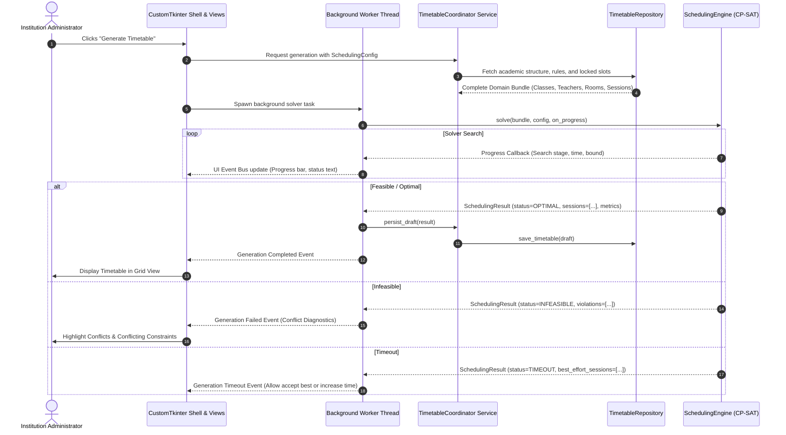

# Timetable Thingy - System Architecture

## 1. System Vision & Overview

**Timetable Thingy** is an offline, local-first academic scheduling application tailored for educational institutions (schools, colleges, polytechnics, and university departments). It solves the complex combinatorial challenge of assigning teachers, subjects, student groups, and rooms to weekly time slots while satisfying hard pedagogical and physical constraints and optimizing for soft faculty preferences.

### Key Architectural Tenets
1. **Local-First & Offline**: Zero cloud dependencies. Persistent storage resides in a local SQLite database.
2. **Strict Layer Separation**:
   - The GUI is completely decoupled from domain logic and solver algorithms.
   - The scheduling engine has zero knowledge of CustomTkinter or UI widgets.
   - The database layer maps domain entities without leaking SQL or ORM constructs into the core solver or UI.
3. **Determinism & Reproducibility**: Given the same configuration, locked assignments, and random seed, the solver produces reproducible schedules.
4. **Interactive & Iterative**: Schedules can be generated automatically, inspected for constraint violations, edited manually with real-time validation, locked in place, and partially regenerated.

---

## 2. Layered Architecture & Dependency Direction

The application follows a clean layered architecture with a strict unidirectional dependency rule:

```
+--------------------------------------------------------------+
|                    Presentation Layer (GUI)                  |
|          CustomTkinter Views, Dialogs, ViewModels            |
+--------------------------------------------------------------+
                               |
                               v
+--------------------------------------------------------------+
|                   Application Service Layer                  |
|    AcademicService, WorkloadService, TimetableCoordinator    |
|               ImportExportService, ReportService             |
+--------------------------------------------------------------+
                               |
                               v
+--------------------------------------------------------------+
|                     Domain Core Layer                        |
|       Entities, Value Objects, Domain Exceptions,            |
|       Validation Rules, Interface Specifications             |
+--------------------------------------------------------------+
            ^                                      ^
            | (Implements)                         | (Implements)
+-----------------------+              +-----------------------+
|  Infrastructure Layer |              | Scheduling Engine     |
|  SQLite Repositories, |              | OR-Tools CP-SAT,      |
|  File System, Exporters|              | Constraint Encoders   |
+-----------------------+              +-----------------------+
```

### Dependency Rules:
- **Presentation (`views/`, `gui/`)** depends ONLY on **Application Services** and **Domain Models**. It NEVER imports the database engine or the solver directly.
- **Application Services** orchestrate business workflows, calling **Domain Models**, **Repositories**, and the **Scheduling Engine** through interface contracts.
- **Domain Core (`core/`)** has **ZERO dependencies** on GUI, SQLite, or OR-Tools. It consists of pure Python standard library types, dataclasses, enums, and typing protocols.
- **Infrastructure (`database/`, `io/`)** implements repository interfaces defined in `core/interfaces.py`.
- **Scheduling Engine (`solver/`)** implements the `TimetableSolver` interface defined in `core/interfaces.py`. It receives pure domain configurations and returns pure domain results.

---

## 3. Module Breakdown & Responsibilities

| Module | Primary Responsibility | Primary Owner |
|---|---|---|
| `core/` | Domain entities, enums, exceptions, and abstract interface contracts. | Agent 1 (System Architect) |
| `database/` | SQLite schema, migrations, connection management, repository implementations. | Agent 2 (Database Architect) |
| `academic/` | Services and view-models for managing institutions, departments, classes, subjects, faculty. | Agent 3 (Academic Management) |
| `workload/` | Workload rules, faculty availability matrices, soft preference configurations, workload analytics. | Agent 4 (Preferences & Workload) |
| `solver/` | OR-Tools CP-SAT model formulation, hard/soft constraint encoding, solver execution, diagnostics. | Agent 5 (Scheduling Engine) |
| `gui/timetable/` | Timetable grid presentation, interactive drag-and-drop/swapping, manual lock/unlock, diff view. | Agent 6 (Timetable Workspace) |
| `exchange/` | CSV/Excel batch import, PDF timetable export, Excel export, analytics reporting. | Agent 7 (Import/Export & Reports) |
| `gui/shell/` | Main application window, navigation sidebar, dashboard, status bar, background worker bus. | Agent 8 (Shell & Integration) |

---

## 4. End-to-End Data Flow: From Configuration to Timetable



---

## 5. Subsystem Communication Protocols

### 5.1 GUI to Service Communication
- The GUI must never perform long-running business computations on the main thread.
- All service methods return typed dataclasses or raise domain exceptions (`core.exceptions`).
- View models wrap service calls and format data for CustomTkinter widgets.

### 5.2 Service to Database Communication
- Services interact with persistence strictly through repository protocols (`InstitutionRepository`, `TimetableRepository`, etc.).
- Unit-of-work or transactional boundaries are handled at the service layer so multi-entity mutations commit or roll back atomically.
- Raw SQL queries must not leak outside the `database/` package.

### 5.3 Solver Integration & Isolation
- The CP-SAT solver consumes an immutable snapshot called `SchedulingInputBundle`.
- The solver does not execute database queries.
- The solver does not interact with Tkinter threads.
- Communication back to the application occurs via:
  1. A thread-safe `ProgressCallback: Callable[[SolverProgress], None]` invoked periodically.
  2. The final `SchedulingResult` returned when execution concludes or times out.

---

## 6. Background Execution & Threading Architecture

CustomTkinter runs on the OS main thread. Long-running tasks (OR-Tools CP-SAT solving, heavy PDF generation, bulk data imports) **must never block the main thread**.

### Worker Concurrency Model:
1. **Thread Pool / Worker Task**: Use Python's standard `concurrent.futures.ThreadPoolExecutor` or dedicated `threading.Thread(daemon=True)`.
2. **Safe Main-Thread Marshalling**:
   - Background threads communicate status updates and completion via `queue.Queue` or a thread-safe callback.
   - The UI polls or schedules periodic checks using CustomTkinter's `root.after(ms, callback)` to consume queue messages and safely mutate UI state.
3. **Cancellation Mechanism**:
   - A `threading.Event` or cooperative cancellation token is passed into long-running operations.
   - The OR-Tools CP-SAT solver supports cancellation via `solver.stop_search()` or time-limit bounds.

```python
# Canonical Background Execution Pattern for Services
import threading
from typing import Callable
from core.models import SolverProgress, SchedulingResult

class BackgroundTask:
    def __init__(self, target: Callable, on_complete: Callable, on_error: Callable):
        self.cancel_event = threading.Event()
        self.thread = threading.Thread(
            target=self._run,
            args=(target, on_complete, on_error),
            daemon=True
        )
        self.thread.start()

    def _run(self, target, on_complete, on_error):
        try:
            result = target(cancel_token=self.cancel_event)
            on_complete(result)
        except Exception as exc:
            on_error(exc)

    def cancel(self):
        self.cancel_event.set()
```

---

## 7. Validation & Error Handling Strategy

### 7.1 Validation Layers
1. **Model Validation (`core.models`)**:
   - Ensures individual fields are valid upon instantiation (e.g., `contact_hours > 0`, non-empty names, valid duration).
2. **Academic Business Rule Validation (`academic`, `workload`)**:
   - Ensures logical consistency before scheduling (e.g., total assigned subject hours match weekly curriculum, teacher is qualified for assigned subject, total required room hours do not exceed available operating hours).
3. **Pre-Flight Feasibility Validation (`solver.preflight`)**:
   - Pigeonhole checks (e.g., required class periods > available weekly periods) executed *before* firing CP-SAT to provide immediate, understandable error messages without burning solver time.
4. **Post-Solve & Manual Edit Validation (`solver.validator`)**:
   - A standalone deterministic validator verifies any schedule against all hard constraints and computes soft penalty scores.
   - When a user moves a session manually in the timetable grid, this validator runs instantly to flag collisions in real time.

### 7.2 Exception Hierarchy (`core.exceptions`)
All domain-specific errors inherit from `TimetableAppError`:
- `ValidationError`: Invalid user input or entity state.
- `RepositoryError`: Persistence / SQLite constraint failure.
  - `EntityNotFoundError`: Requested record missing.
  - `ConcurrencyError`: Conflicting updates on timetable versions.
- `SchedulingError`: Solver-related failures.
  - `InfeasibleScheduleError`: Impossible constraint combination.
  - `SolverTimeoutError`: Solver limit reached without a complete solution.
  - `InvalidConfigurationError`: Malformed parameters passed to solver.
- `ImportExportError`: Format or parsing issues during CSV/Excel/PDF operations.

---

## 8. Testing Strategy

The architecture mandates independent testability across all layers without spinning up the GUI:

1. **Unit Tests (`tests/unit/`)**:
   - Test `core/models.py` validation, duration computations, credit vs contact hour logic.
   - Test repository queries using in-memory SQLite databases (`:memory:`).
   - Test individual constraint formulations in the solver using miniature mock bundles.
2. **Integration Tests (`tests/integration/`)**:
   - Test full pipeline: Seed academic data -> invoke solver -> assert valid `SchedulingResult` -> save to SQLite -> load back.
   - Test manual edit validation and partial regeneration.
3. **Property & Constraint Invariant Tests**:
   - Every generated timetable must pass the standalone validator with `violations == []`.
   - Teacher double-booking invariant: `count(teacher, timeslot) <= 1`.
   - Room double-booking invariant: `count(room, timeslot) <= 1`.
   - Class double-booking invariant: `count(class_group, timeslot) <= 1`.
